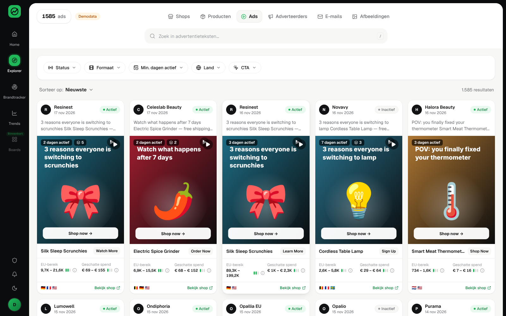

# Trendscope (werknaam)

Trendscope is een all-in-one platform voor e-commerce trend- en concurrentie-intelligentie. Het koppelt producten, winkels, advertenties, creators, zoektrends en leveranciers aan elkaar. Elk product krijgt een **groeisnelheid**, een **validatiescore**, een **saturatiescore** en een **opportuniteitsscore**, en het platform laat altijd zien *waarom* een product zo scoort.

> **Status: fase 10 is klaar (billing, limieten, team en admin).** Daaronder: AI-assistent (fase 9), alerts en integraties (fase 8), e-mailmarketing en funnels (fase 7), TikTok Shop en creators (fase 6), trenddetectie en live scoring (fase 5), productclustering en marktplaatsen (fase 4), ad intelligence (fase 3) en store intelligence (fase 2). Alles draait op een deterministisch "nep-internet", met precies de productiecode die straks de echte API's aanroept.
> Architectuurplan: [`docs/ARCHITECTURE.md`](docs/ARCHITECTURE.md). Onderzoek naar de UX van TrendTrack: [`docs/research/trendtrack-ux.md`](docs/research/trendtrack-ux.md).

| Shop Explorer | Winkeldetail |
|---|---|
|  |  |
| **Producten met scores** | **Productdetail: "Waarom deze score?"** |
|  |  |
| **Home-dashboard** | **Ads-explorer** |
|  |  |

---

## Lokaal starten

**Vereisten:** Docker, Node 22 met pnpm 10 (`corepack enable`) en [uv](https://docs.astral.sh/uv/).

```bash
make setup          # pnpm install + uv sync + .env aanmaken uit .env.example
make dev-services   # Postgres (pgvector), ClickHouse, Redis, Meilisearch, MinIO, Mailpit
make migrate        # Postgres- en ClickHouse-migraties
make seed           # demowereld + 14 dagen crawls, ads & discovery + screenshots + zoekindex (±4 min)
make dev            # http://localhost:3000
make worker         # (optioneel) Celery: scheduler + crawls draaien continu op de achtergrond
```

Log in met elk e-mailadres; in dev-modus is geen wachtwoord nodig. Daarna volgt een korte onboarding: je kiest je rol, je niches en je landen, en het dashboard past zich daaraan aan.

`make help` toont alle commando's. `make check` draait wat CI ook draait: lint, typecheck en tests.

### API-keys en accounts

**Voor fase 1 is geen enkele externe key nodig.** Alle connectors draaien in `DATA_MODE=mock`.

| Variabele | Nodig vanaf | Waarvoor |
|---|---|---|
| `AUTH_SECRET` | nu | Ondertekent de dev-sessiecookie (min. 32 tekens) |
| `NEXT_PUBLIC_CLERK_PUBLISHABLE_KEY`, `CLERK_SECRET_KEY`, `CLERK_WEBHOOK_SECRET` | productie | Clerk-auth (Google, magic link, 2FA, organisaties); zet `AUTH_MODE=clerk` |
| `META_AD_LIBRARY_ACCESS_TOKEN` | live ads | Meta Ad Library API (geverifieerd Meta-account + akkoord met de API-voorwaarden) |
| `TIKTOK_CLIENT_KEY`, `TIKTOK_CLIENT_SECRET` | live ads | TikTok Commercial Content API (toegang via aanvraag) |
| `GOOGLE_APPLICATION_CREDENTIALS` | live ads | BigQuery (Google Ads Transparency-dataset) |
| `ALIEXPRESS_APP_KEY`, `ALIEXPRESS_APP_SECRET` | live marktplaatsen | AliExpress Affiliate API (Open Platform / Portals-account) |
| `AMAZON_CREATORS_CLIENT_ID`, `AMAZON_CREATORS_CLIENT_SECRET`, `AMAZON_PARTNER_TAG` | live marktplaatsen | Amazon Creators API (Associates-account; opvolger van PA-API 5) |
| `CJ_API_KEY` | live marktplaatsen | CJ Dropshipping API v2 |
| `DATAFORSEO_LOGIN`, `DATAFORSEO_PASSWORD` | live trends | Zoekinteresse (Google Trends via DataForSEO, tot de officiële Trends API open is) |
| `REDDIT_CLIENT_ID`, `REDDIT_CLIENT_SECRET` | live trends | Reddit Data API (commercieel gebruik vereist een overeenkomst met Reddit) |
| `TIKTOK_PARTNER_BASE_URL`, `TIKTOK_PARTNER_API_KEY` | live social | TikTok Shop- en creatordata via een gelicentieerde datapartner (geen officiële API voor derden) |
| `YOUTUBE_API_KEY` | live social | YouTube Data API v3 |
| `INSTAGRAM_ACCESS_TOKEN`, `INSTAGRAM_USER_ID` | live social | Instagram Graph API (Business Discovery, eigen Business-account) |
| `EMAIL_IMAP_HOST`, `EMAIL_IMAP_USER`, `EMAIL_IMAP_PASSWORD`, `EMAIL_SEED_DOMAIN` | live e-mail | Seed-mailbox op een eigen domein (IMAP, alleen-lezen) |
| `APP_ENCRYPTION_KEY` | productie | Versleutelt kanaalsecrets (webhook-URL's, bot-tokens); `openssl rand -base64 32` |
| `CRON_SECRET` | productie | Beveiligt `/api/cron/alerts` (Vercel Cron) |
| `RESEND_API_KEY`, `EMAIL_FROM` | live e-mail | Digests en e-mailalerts (zonder sleutel: alleen gelogd) |
| `ANTHROPIC_API_KEY` | AI | Assistent, rapporten, ad-copy en creative-analyse met Claude (zonder sleutel: offline-modus) |
| `WHISPER_MODEL` | optioneel | Lokaal faster-whisper-model voor transcriptie van video-ads |
| `CHROME_PATH` | optioneel | Chromium voor Playwright-screenshots |
| `ANTHROPIC_API_KEY` | fase 9 | AI-assistent en rapporten |
| `STRIPE_SECRET_KEY`, `STRIPE_WEBHOOK_SECRET` | fase 10 | Billing |

---

## Wat er in fase 10 gebouwd is (billing, limieten, team en admin)

- **Prijspagina** (`/pricing`, publiek): Free, Starter, Pro en Agency/Business, maandelijks of jaarlijks (2 maanden gratis), met alle limieten per plan.
- **Stripe**:
  - Checkout met 7 dagen trial, btw via Stripe Tax, btw-nummer en kortingscodes.
  - Klantportaal voor betaalmethode, facturen, opzeggen en plan wisselen.
  - Ondertekende, idempotente webhooks (`/api/webhooks/stripe`).
  - Facturen in de app (`/settings/billing`), met gebruik per limiet.
- **Zonder `STRIPE_SECRET_KEY`**: een demo-checkout met hetzelfde effect in de app (plan, status, factuurregel), duidelijk gelabeld als "Demo-abonnement".
- **Trial**: nieuwe workspaces starten op Pro (7 dagen) en vallen daarna automatisch terug naar Free. De data blijft, alleen de limieten en het historievenster gaan omlaag.
- **Afgedwongen limieten** (één definitie in `packages/core`, tellers atomair in de database):
  - zoekopdrachten per dag in de explorer, met een upsell-melding;
  - gevolgde winkels, alertregels, exports, AI-vragen en seats;
  - het historievenster op product- en winkeldetail.
- **Team** (`/settings`):
  - Leden uitnodigen als lid of beheerder, binnen het aantal seats van het plan. Een uitnodiging is 7 dagen geldig en werkt alleen voor het juiste e-mailadres.
  - Leden verwijderen en uitnodigingen intrekken.
  - Wisselen tussen workspaces als je in meerdere teams zit.
- **Admin-paneel** (`/admin`, alleen voor platformbeheerders; voor anderen een 404):
  - *Overzicht*: databronnen, wachtrij, clustering en backtests.
  - *Gebruikers & plannen*: zoeken, plan handmatig wijzigen en platformbeheer toekennen.
  - *Scoregewichten*: een nieuwe versie maken (als concept of direct actief), eerdere versies terugzetten, met de backtest-precisie per versie.
  - *Feature flags*: uitrol per percentage en/of plan.
  - *Curatie*: winnende producten uitlichten, die een badge krijgen en filterbaar zijn in de explorer.
  - Elke beheeractie staat in de audit log.
- **Tests**: unit-tests voor de feature-flag-uitrol, en e2e voor prijzen en demo-checkout, alle admin-tabbladen, de 404 voor niet-beheerders, de zoeklimiet op Free en de volledige uitnodigingsflow (inclusief een vreemde die de link probeert). Daarnaast een integratietest van de Stripe-webhook: handtekening, plan omhoog en omlaag, en een dubbel event dat maar één keer telt.

Zie [ADR 0010](docs/adr/0010-fase-10-billing-admin.md).

## Wat er in fase 9 gebouwd is (AI-assistent, rapporten, transcriptie en OCR)

- **Assistent** (`/assistant`): chat met de data. Claude Opus 5.5 gebruikt de tool runner met zeven alleen-lezende tools: producten, productdetail, trends, winkels, ads, TikTok Shop en niches.
  - Het antwoord streamt naar de browser, met links naar de bron.
  - Gesprekken worden per workspace bewaard, en elke vraag telt mee voor de planlimiet.
- **AI-rapport per product**: doelgroep, USP's, ad-hoeken met hooks, prijsadvies (op basis van prijsrange, inkoop en marge), risico's met ernst, en een oordeel met betrouwbaarheid. Gestructureerde output, gecachet per product en vernieuwd zodra de data verandert.
- **Ad-copy-generator**: hooks, primaire teksten, koppen, een productbeschrijving en winkelnaam-ideeën, met kopieerknoppen.
- **Creative-analyse** in de worker (elke 20 minuten; CLI `trendscope analyze-creatives`): OCR, hook en hook-type, invalshoek, CTA en claims per ad, met Claude vision op beelden uit onze eigen opslag. Transcriptie gebeurt optioneel lokaal met Whisper.
- **Zonder `ANTHROPIC_API_KEY`**: een offline-modus met dezelfde tools en schema's, regelgebaseerd en duidelijk gelabeld. Als er geen exacte treffer is, versoepelt hij de filters en zegt dat erbij.
- **Tests**: de offline hook-classificatie, de veiligheid van de Markdown-weergave en de CLI (unit); assistent, rapport, ad-copy en creative-analyse (e2e). De e2e-tests vonden twee bugs in de intentieherkenning en de Markdown-weergave, en die zijn opgelost.

Zie [ADR 0009](docs/adr/0009-fase-9-ai.md).

## Wat er in fase 8 gebouwd is (watchlists, alerts, digests en integraties)

- **Regelbouwer** (`/alerts`), zonder code, met zeven begrensde soorten regels (zod-schema in `@trendscope/core`):
  - score boven of onder een grens;
  - faseverandering;
  - winkel voegt veel producten toe;
  - adverteerder start veel ads;
  - zoekterm of hashtag groeit snel;
  - prijsdaling bij een gevolgde concurrent;
  - nieuwe winkel in een niche.

  Per regel kies je een bereik (wat je volgt, of alles), kanalen en een cooldown.
- **Evaluatie**: de knop "Nu controleren" en de cron-route `/api/cron/alerts` (Vercel Cron, elke 15 minuten, met `CRON_SECRET`). Meldingen worden ontdubbeld per entiteit en cooldown. De bel in de zijbalk toont het aantal ongelezen meldingen.
- **Kanalen**: in de app, e-mail (Resend), Slack, Discord, Telegram en een generieke webhook (HMAC-SHA256-ondertekend). De worker bezorgt met retries en weigert privé-adressen (SSRF-bescherming bij opslaan én bij verzenden). Secrets staan versleuteld (AES-256-GCM, hetzelfde formaat in Node en Python) en worden nooit meer getoond.
- **Digests** per gebruiker (uit, dagelijks of wekelijks): nieuwe meldingen, de sterkste kansen in de eigen niches en opkomende zoektermen.
- **Tests**:
  - schema en SSRF-regels (vitest);
  - payloads per kanaal, de webhookhandtekening en de versleuteling over de taalgrens heen (pytest);
  - bezorging, retries, het weigeren van privé-doelen en het eenmaal-per-periode-gedrag van digests (integratie);
  - de volledige flow van kanaal tot regel tot melding tot bel (e2e).

Zie [ADR 0008](docs/adr/0008-fase-8-alerts.md).

## Wat er in fase 7 gebouwd is (e-mailmarketing en funnel-analyse)

- **Seed-mailbox** ([`seed_mailbox.md`](docs/sources/seed_mailbox.md)): per winkel een eigen plus-adres, ingeschreven via het openbare Shopify-formulier. Bij een CAPTCHA wordt de inschrijving `manual`; we omzeilen niets. Mails lezen we alleen-lezend via IMAP in (UID-incrementeel, idempotent op Message-ID).
- **Verwerking**:
  - type (welkom, bevestiging, promotie, lancering, nieuwsbrief, verlaten winkelmand, transactioneel), met regels in NL/EN/DE;
  - hoogste korting, kortingscode, gratis verzending en urgentie;
  - het verzendplatform uit de headers;
  - productlinks gekoppeld aan producten van de winkel.

  Per winkel: mails per week, gemiddelde korting en het e-mailplatform.
- **E-mailarchief** (`/explorer/emails`) met filters (type, minimale korting, urgentie) en een **viewer**. De HTML wordt eerst gesaneerd (getest) en dan in een sandbox-iframe zonder scripts of same-origin getoond. Trackingpixels gaan eruit, en externe afbeeldingen laden pas na een klik.
- **Funnel-analyse** op de winkelpagina: tools per stap (landing, capture, product, winkelmand, checkout en retentie), herkend met 13 nieuwe signaturen voor pop-ups, spin-wheels, urgentie, bundels, upsells, gratis-verzendbalken, loyaliteit, quiz en chat.

Zie [ADR 0007](docs/adr/0007-fase-7-email-funnels.md).

## Wat er in fase 6 gebouwd is (TikTok Shop, creators, video's en livestreams)

- **Bronnen**, elk met manifest en juridische notitie:
  - **TikTok Shop en creators** via een datapartner ([`tiktok_shop_partner.md`](docs/sources/tiktok_shop_partner.md)). TikTok heeft voor deze data van derden geen officiële API. De connector staat op *pending/hoog risico* en gebruikt een neutraal datacontract met een adapter per partner.
  - **YouTube Data API v3** ([`youtube_data.md`](docs/sources/youtube_data.md)) en **Instagram Business Discovery** ([`instagram_business.md`](docs/sources/instagram_business.md)).
- **Pipeline** (`workers/src/trendscope/social/`):
  - categorie-ontdekking maakt shop- en creator-targets aan;
  - van elk product bewaren we de verkochtteller als snapshot, zodat verkopen per dag en per 30 dagen verschillen tussen onze eigen metingen zijn;
  - TikTok Shop-producten clusteren met de bestaande producten;
  - video's koppelen we via het productanker (of via de titel);
  - livestreams leggen we vast met het aantal verkochte stuks per product.
- **Schattingen**: GMV van een shop en van een livestream (tellerstand × prijs, betrouwbaarheid *medium*) en GMV van een creator (views × CTR × conversie + live-verkopen, *laag*), altijd met methode en bandbreedte.
- **Scoring**: de signalen `tiktokshop` (verkochte stuks per dag) en `social` (videoviews per dag) zijn nu live.
- **Social-sectie** (`/social`) met vijf rankings: producten (verkopen per dag als sparkline, GMV, commissie), shops, creators, video's (snelste groei in 24 uur) en livestreams. Creator-discovery met filters op niche, platform, volgers, engagement en zakelijk contact. Een creatorpagina met volgersgroei, video's, gepromote producten en livestreams.
- **Productdetail**: een kaart "Op TikTok Shop" met shops, verkopen, GMV en commissie.
- **AVG**: alleen publieke profielen, en contact alleen als zelf gepubliceerd zakelijk e-mailadres. Daar zijn tests voor.

Zie [ADR 0006](docs/adr/0006-fase-6-social-commerce.md).

## Wat er in fase 5 gebouwd is (trenddetectie en live scoring)

- **Vraagbronnen**, elk met manifest en juridische notitie:
  - **Zoekinteresse** per land (NL, DE, GB, US) over 2 jaar, via DataForSEO's Google Trends-endpoint ([`dataforseo_trends.md`](docs/sources/dataforseo_trends.md)). De officiële Google Trends API is nog alpha.
  - **Reddit Data API** (OAuth): posts van de afgelopen week per zoekterm, zonder gebruikersnamen ([`reddit.md`](docs/sources/reddit.md)).
  - **Hashtags** afgeleid uit ad-teksten die we al hebben, dus zonder extra bron.
- **Live scoring** (`workers/src/trendscope/scoring/live.py`). Elke dag (Celery beat; CLI `trendscope score`) worden de signalen per product afgeleid uit de echte tabellen: winkels, actieve ads, marktplaatsverkopen, zoekinteresse en Reddit. Daarna wordt alles gescoord en uitgelegd. Waar een live meting aansluit op bestaande historie, wordt één schaalfactor vastgelegd (`signal_scales`), zodat er geen kunstmatige sprong ontstaat. Producten met minder dan 7 dagen data tonen "Score volgt".
- **Forecasts** voor 90 dagen (Holt-Winters met weekritme en gedempte trend, ~90%-band, fout gemeten op de laatste 14 dagen), voor zoektermen en voor de vraag per product.
- **Seizoenen** worden alleen herkend als het maandprofiel van het laatste jaar dat van het jaar ervoor herhaalt. Een stijger is geen seizoen.
- **Backtesting** (`trendscope backtest`, wekelijks): de scoring draait opnieuw op 14, 21 en 30 dagen geleden, zonder kennis van daarna, en wordt vergeleken met de vraaggroei die volgde (Spearman, precisie@10, AUC tegenover de basiskans). De resultaten staan in admin.
- **Trends-pagina** met vier tabbladen:
  - zoektermen, met filters op land, periode, fase en niche, en het label "Nog geen product" als kans;
  - hashtags;
  - niches;
  - een seizoenskalender die markeert wanneer je moet beginnen met testen.
- **Keyword-detail**: interesse per land, forecast met band, gekoppelde producten en Reddit-posts.
- **Productdetail**: een vraagverwachting voor 90 dagen en de zoektermen waaronder het product gezocht wordt.
- **Tests**: unit-tests voor de parsers, forecast, seizoen, fase (identiek in Python en TypeScript) en de backtest-metrieken. De integratietest controleert fases, seizoenen, Reddit-idempotentie, kalibratie, scoring en dat de backtest de basiskans verslaat. De e2e-tests dekken de trends, de hashtags, de seizoenskalender, de forecast en de backtest in admin.

Zie [ADR 0005](docs/adr/0005-fase-5-trends-scoring.md).

## Wat er in fase 4 gebouwd is (productdatabase en clustering)

- **Marktplaats-connectors**, elk met manifest en juridische notitie:
  - **AliExpress Affiliate API**: ondertekende aanvragen (HMAC-SHA256), verkocht-in-30-dagen, beoordeling, levertijd en verkoper. Notitie: [`aliexpress_affiliate.md`](docs/sources/aliexpress_affiliate.md).
  - **Amazon Creators API**: OAuth-token en `searchItems`, met prijs en Best Sellers Rank. Uit de BSR schatten we de maandverkopen, getoond als schatting met bandbreedte. Notitie: [`amazon_creators_api.md`](docs/sources/amazon_creators_api.md).
  - **CJ Dropshipping API v2**: producten plus de goedkoopste verzendoptie naar NL. Notitie: [`cj_dropshipping.md`](docs/sources/cj_dropshipping.md).
  - **Temu**: afgewezen, want er is geen officiële API ([`temu.md`](docs/sources/temu.md)). De connector staat uit en de productie-guard weigert hem.
- **Clustering-engine** (`workers/src/trendscope/clustering/`):
  - tekstembeddings (256-d, pgvector HNSW) en een 64-bit perceptual hash per afbeelding;
  - een score uit tekst (cosinus + containment) en beeld;
  - nieuwe clusters uit ongeclusterde producten van verschillende herkomst;
  - samenvoegen van dubbele clusters, met audit in `cluster_members.evidence` en `cluster_merges`.
- **Pipeline**: winkelcrawls slaan embeddings op en matchen snel op titel. De clustering-job (Celery beat, elke 30 minuten; CLI `trendscope cluster`) pakt de rest op. Marktplaatslistings worden direct geclusterd, en hun aanbiedingen worden leveranciers.
- **Productdetail**:
  - een kaart "Op marktplaatsen" met per listing verkopen, BSR (met schatting), beoordeling en het matchbewijs (tekst %, beeld %);
  - een leveranciersvinder (totale geleverde prijs, goedkoopst/snelst) die zijn inkoop- en verzendkosten in de margecalculator zet;
  - BTW en retouren in de calculator;
  - vergelijkbare producten via vectorzoektocht;
  - "Score volgt" voor nieuw ontdekte producten (geen nepscores).
- **Producten-explorer**: bronfilter (winkels / marktplaatsen / beide), kolommen voor marktplaatsverkopen en laagste inkoop, en sorteren op marktplaatsverkopen.
- **Admin**: de gezondheid van de clustering (aandeel geclusterd, zelf ontdekt, meerdere bronnen, samengevoegd, wachtend, zonder match).
- **Tests**: unit-tests voor signing, parsers, BSR-schatting, scores en pHash. De integratietest controleert dat 100% van de demolistings bij het juiste product landt, plus idempotentie, prijswijzigingen en de merge-audit. E2e test de bron-filter, de detailpagina, de leverancierskeuze, "Score volgt" en admin.

Zie [ADR 0004](docs/adr/0004-fase-4-producten-clustering.md).

## Wat er in fase 3 gebouwd is (ad intelligence)

- **Connectors** voor officiële bronnen, elk met een eigen manifest en juridische notitie in [`docs/sources/`](docs/sources/):
  - **Meta Ad Library API** (`ads_archive`): adverteerders volgen per pagina en nieuwe adverteerders vinden via zoektermen, incrementeel en met paginering. Het access token wordt nooit opgeslagen of gelogd.
  - **TikTok Commercial Content API**: OAuth (client credentials), paginering via `search_id`, video's/beelden en bereikbandbreedtes.
  - **Google Ads Transparency** via de publieke BigQuery-dataset, met een kostenlimiet per query.
- **Ingest** (`ads/ingest.py`):
  - events: gestart, gestopt, nieuwe adverteerder en **opschalend** (een creative krijgt varianten bij);
  - snapshots alleen bij een wijziging;
  - **varianten** herkend als dezelfde creative;
  - **schattingen** van bereik en spend, altijd met bandbreedte, betrouwbaarheid en methode.
- **Koppeling** ad → winkel (landingsdomein; voor TikTok en Google op naam) en ad → product (exact via `/products/<handle>`, anders via de tekst). Onbekende domeinen worden discovery-kandidaten. Ads verschijnen ook in de winkeltijdlijn.
- **Media**:
  - content-addressed opslag in S3;
  - **winkelscreenshots** via Playwright;
  - een mediaproxy die alleen aan ingelogde gebruikers serveert;
  - het kopiëren van Meta-creatives staat uit tot er juridisch akkoord is.
- **UI**:
  - de Ads-explorer met de weergaven *Lang lopend*, *Schalend*, *Nieuw deze week* en *Nieuwe adverteerders*, plus een platformfilter;
  - een **ad-detailpagina** met varianten, gekoppelde producten en het bereik door de tijd;
  - een **adverteerderprofiel** met actieve ads door de tijd, landen, formaten en top-producten;
  - **Boards** (swipe-file) met opslaan vanuit elke ad, notities, tags en tagfilter, afgeschermd per workspace.

| Kwaliteit | Resultaat |
|---|---|
| Python-tests | 59, waarvan 12 integratietests |
| Unit-tests web | 29 |
| Playwright e2e-tests | 20 |

Zie [ADR 0003](docs/adr/0003-fase-3-ad-intelligence.md).

## Wat er in fase 2 gebouwd is (store intelligence)

- **Shopify-crawler** (`workers/.../pipeline/store_crawl.py`):
  - haalt `/products.json` op en valt terug op de sitemap als een winkel die uitschakelt;
  - haalt bestsellers uit een collectie die de winkel zelf zo markeert, conform robots.txt (`sort_by` is daar verboden);
  - diff-detectie: nieuw, verwijderd, prijs, vergelijkprijs, voorraad, varianten en titel;
  - snapshots **alleen bij een wijziging**;
  - nieuwe producten worden automatisch aan trendclusters gekoppeld.
- **Detectie** van platform (Shopify, WooCommerce, Magento, BigCommerce, Wix), pixels, apps, e-mail- en reviewtools, betaalmethoden, thema, valuta, taal, land en social-accounts. Elke detectie bewaart bewijs.
- **Scheduler + Celery**:
  - adaptief interval: 6 uur, 24 uur of 3 dagen;
  - prioriteit op basis van watchlists, groei en verkeer;
  - leases met `SKIP LOCKED`;
  - retries met backoff en dead letters;
  - een Redis-rate-limiter die over alle workers heen werkt.
- **Store discovery**: Certificate Transparency (crt.sh), ad-landingspagina's en CSV-import → probe → nieuwe winkel met een crawl-target.
- **UI**:
  - een winkeltijdlijn met filters, 7-dagentellers, de crawlstatus en een "Nu crawlen"-knop;
  - de weergave "Nieuwe lanceringen", een platformfilter en sorteren op recente wijzigingen;
  - het freshness-dashboard in Admin: versheid per bron, wachtrij, dead letters, kandidaten en fouten;
  - **⌘K-zoeken** via Meilisearch (typo-tolerant, met Postgres als terugval);
  - een activiteitenfeed op Home.
- **Nep-internet** voor mock-modus (`trendscope.mockweb`): de 180 demowinkels veranderen dag na dag, en er staan 22 onontdekte sites klaar. Zo draait en test de échte pipeline zonder externe toegang.

| Kwaliteit | Resultaat |
|---|---|
| Python-tests | 38, waarvan 7 integratietests tegen Postgres, ClickHouse en Redis |
| Unit-tests web | 28 |
| Playwright e2e-tests | 14 |

Zie [ADR 0002](docs/adr/0002-fase-2-store-intelligence.md) en [`docs/sources/`](docs/sources/) voor de juridische notities per bron.

## Wat er in fase 1 gebouwd is

**Web-app** (`apps/web`, Next.js 15 + Tailwind 4):
- App-shell in de stijl van TrendTrack: een donkere zijbalk en een afgerond inhoudspaneel, in licht én donker thema. De app is volledig tweetalig (NL/EN).
- **Shop Explorer**:
  - opgeslagen weergaven: Weekly Gems, Top Scaling, Marktleiders, Advertentiepiek en Trafficpiek;
  - 16 filters: bezoekerslanden, herkomst, verkeer, niche, aantal producten, aanmaakdatum, trafficgroei, pixels, taal, thema, apps, valuta, actieve ads en ads-groei;
  - sortering, een lijst- en rasterweergave, sparklines, paginering en CSV-export (met planlimiet).
- **Winkeldetail**:
  - KPI's: bezoeken, geschatte omzet met bandbreedte en betrouwbaarheid, live ads en volgers;
  - grafieken voor verkeer en live ads door de tijd;
  - verkeer per land, verkeersbronnen, pixels, apps en betalingen;
  - bestsellers en laatst gepubliceerde producten, ads en volgers;
  - **gekoppelde trendproducten met hun score**: dit is onze differentiator.
- **Producten-explorer** met opportuniteit, validatie (welke signalen positief zijn), saturatie, groei, trendfase en de vraagcurve.
- **Productdetail**:
  - het "Waarom deze score?"-paneel met de bijdrage per signaal, de signaalgroepen, bonussen en straffen;
  - een signaal-index door de tijd en het scoreverloop;
  - leveranciers met een interactieve margecalculator;
  - de winkels die het product verkopen, ads, TikTok-video's en vergelijkbare producten.
- **Ads-explorer**: een creatives-galerij met de filters status, formaat, dagen actief, land en CTA. EU-bereik en spend worden altijd als schatting getoond.
- **Overige schermen**: Adverteerders, Home-dashboard, Brandtracker (winkels en producten volgen), Trends per niche, Admin (databronstatus en scoregewichten), Instellingen en Onboarding.
- **Auth**:
  - een dev-login met een HMAC-ondertekende cookie, plus Clerk voor productie (webhook-sync via Svix);
  - workspaces met de rollen owner, admin en member;
  - planlimieten en audit-logs.

**Workers** (`workers`, Python 3.12):
- `PoliteHttpClient`: respecteert robots.txt, hanteert een rate limit per domein en globaal, gebruikt een identificeerbare User-Agent, doet backoff met `Retry-After` en ondersteunt conditional requests.
- Het connector-framework werkt met een manifest per bron. Productie weigert connectors zonder juridisch akkoord.
- De **Shopify-connector** parseert `/products.json`, met een fixture en wijzigingsdetectie via content-hash.
- De **scoring-engine** berekent groei, percentielen per categorie, onafhankelijke signaalgroepen, een poort bij minder dan 3 signalen, een convergentiebonus, een concentratiestraf, saturatie, opportuniteit en de trendfase, met een volledige uitleg.
- De seed-generator vult Postgres en ClickHouse met een samenhangende demowereld.

**Data:** 4 Postgres-migraties (met werkende down-migraties, RLS en pgvector) en 2 ClickHouse-migraties (snapshots, dagelijkse signalen, scorehistorie en winkelmetrics).

**Kwaliteit:**

| Wat | Resultaat |
|---|---|
| TypeScript-unit-tests | 28 |
| Python-tests | 19 (incl. integratie) |
| Playwright end-to-end-tests | 8 |
| Typecheck | strict TS + mypy strict |
| Lint | ruff |
| CI | `.github/workflows/ci.yml` (incl. migraties op en neer, seed, controle op actuele gegenereerde types, build en e2e) |

**Performance (lokaal, productie-build, demodata):** de meeste schermen laden in 50–215 ms per pagina, ook met filters.

## Bekende beperkingen

- **Alle data is fictief** (label "Demodata"). In mock-modus crawlt de pipeline een nep-internet. Echte winkels crawlen vereist `DATA_MODE=live` **én** `legal_review: approved` in het connector-manifest. In productie weigert de scheduler connectors zonder akkoord.
- **Verkeer en omzet van ontdekte winkels** tonen we als "—". Daarvoor is een datapartner nodig (clickstream).
- **Ad-dekking volgt de bronnen:** Meta alleen ads met EU-levering, Google alleen EER/Turkije, en TikTok-toegang mogelijk alleen voor onderzoek (juridisch toetsen).
- **Creatives van Meta** komen alleen uit snapshots. Dat staat in productie uit (`META_SNAPSHOT_CAPTURE=false`) tot er juridisch akkoord is.
- **Seats met Clerk-organisaties** worden nog niet tegen het plan afgedwongen (in dev-auth wel). Echte Stripe-betalingen zijn zonder account niet end-to-end getest. De webhookverwerking is wel getest, met ondertekende events tegen de echte database (alleen het ophalen van het abonnement bij Stripe is gestubd).
- **Lokale S3:** Docker Hub publiceert geen MinIO-images meer, dus compose gebruikt `quay.io/minio/minio`.
- **Tekstembeddings** zijn hashing-gebaseerd (geen extern model): goed voor varianten van dezelfde titel, maar zonder synoniemen ("hair clip" ≠ "claw clip"). Het beeldsignaal vangt een deel op. Een echt embeddingmodel is de eerste upgrade.
- **Amazon Creators API**: de responsstructuur is nog niet tegen een echt account geverifieerd; de parser is tolerant en de eerste echte respons moet een fixture worden.
- **Nieuwe clusters** krijgen een score zodra er 7 dagen data is; tot dan staat er "Score volgt".
- **Zoekinteresse** is relatief (0–100 per venster). Absolute zoekvolumes en een echte Google Trends API-koppeling volgen zodra er toegang is.
- **Backtests** op de demodata zeggen iets over de werking van de methode, niet over de echte markt. Met echte data kunnen de gewichten worden afgesteld op deze metrieken.
- **Marktplaatsafbeeldingen** kopiëren we alleen in mock-modus naar S3 (`STORE_MARKETPLACE_IMAGES=false` in productie, tot er juridisch akkoord is); de pHash wordt wel altijd berekend.
- **Clerk** is geïmplementeerd maar zonder echte keys niet getest.
- Er zijn nog geen deploy-workflows (Vercel/Hetzner) en geen Terraform.
- Afwijkingen van het oorspronkelijke plan staan in [`docs/adr/0001-fase-1-keuzes.md`](docs/adr/0001-fase-1-keuzes.md).

## Volgende stap: fase 11 (Chrome-extensie, push-to-store, publieke API en leads-export)

- Een Chrome-extensie (MV3) die op elke webshop laat zien wat Trendscope weet.
- Een product met één klik als concept naar je eigen Shopify-winkel.
- Een publieke REST API v1 met API-sleutels, rate limiting en OpenAPI-documentatie.
- Een B2B-leads-export van winkels, met alleen zakelijke gegevens.

## Structuur

```
apps/web            Next.js-app (UI, server actions, API-routes)
packages/db         Kysely-client + gegenereerde types (bron: SQL-migraties)
packages/core       Domeinlogica: plannen/limieten, rechten, schattingen, unit economics
workers/            Python: connectors, HTTP-client, scoring, seed, CLI
db/postgres         dbmate-migraties
db/clickhouse       ClickHouse-migraties
infra/docker        docker-compose voor lokale ontwikkeling
docs/               architectuur, ADR's, bronnen (juridisch), onderzoek, screenshots
```
