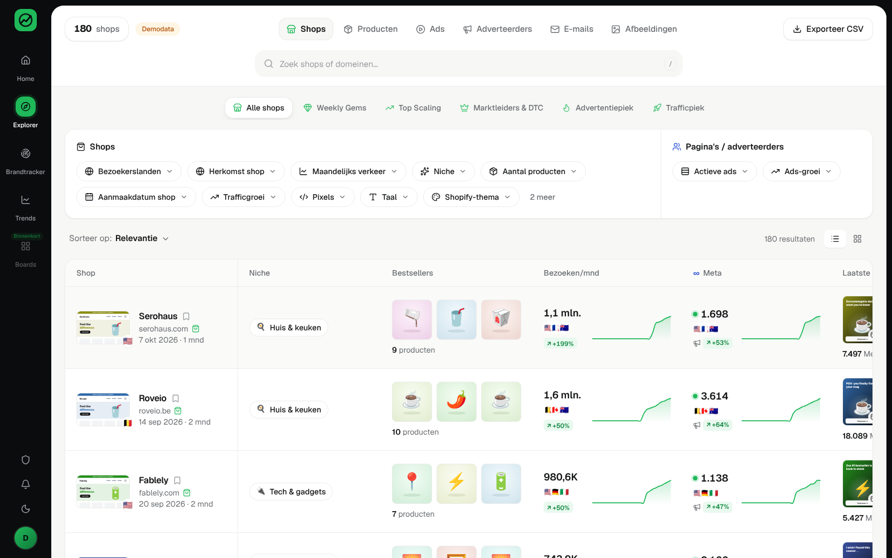
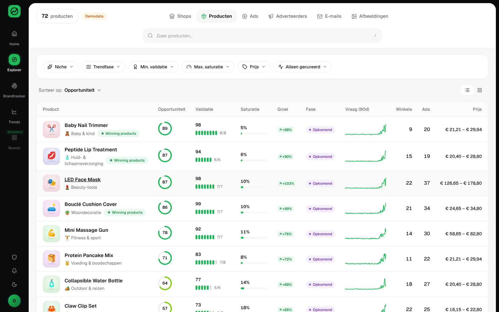
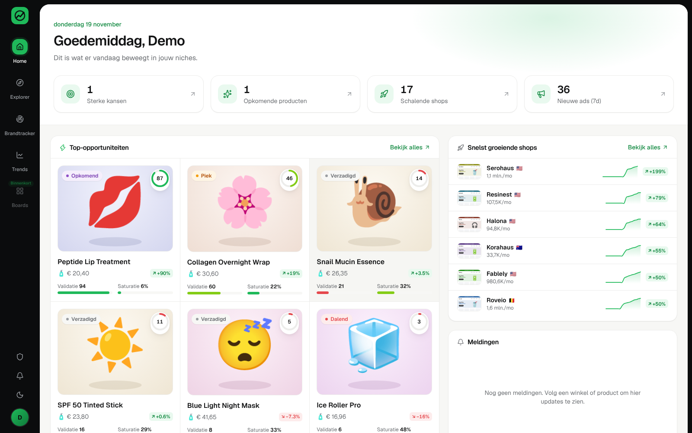

# Trendscope (werknaam)

Trendscope is een all-in-one platform voor e-commerce trend- en concurrentie-intelligentie. Het koppelt producten, winkels, advertenties, creators, zoektrends en leveranciers aan elkaar. Elk product krijgt een **groeisnelheid**, een **validatiescore**, een **saturatiescore** en een **opportuniteitsscore**, en het platform laat altijd zien *waarom* een product zo scoort.

> **Status: fase 3 is klaar (ad intelligence).** Connectors voor Meta Ad Library, TikTok Commercial Content API en Google Ads Transparency (BigQuery), koppeling van ads aan winkels en producten, schattingen met bandbreedte, creatives en winkelscreenshots in S3, en een swipe-file met boards. Alles draait op een deterministisch "nep-internet", met precies de productiecode die straks de officiële API's aanroept.
> Architectuurplan: [`docs/ARCHITECTURE.md`](docs/ARCHITECTURE.md). Onderzoek naar de UX van TrendTrack: [`docs/research/trendtrack-ux.md`](docs/research/trendtrack-ux.md).

| Shop Explorer | Winkeldetail |
|---|---|
|  |  |
| **Producten met scores** | **Productdetail: "Waarom deze score?"** |
|  |  |
| **Home-dashboard** | **Ads-explorer** |
|  |  |

---

## Lokaal starten

**Vereisten:** Docker, Node 22 met pnpm 10 (`corepack enable`) en [uv](https://docs.astral.sh/uv/).

```bash
make setup          # pnpm install + uv sync + .env aanmaken uit .env.example
make dev-services   # Postgres (pgvector), ClickHouse, Redis, Meilisearch, MinIO, Mailpit
make migrate        # Postgres- en ClickHouse-migraties
make seed           # demowereld + 14 dagen crawls, ads & discovery + screenshots + zoekindex (±4 min)
make dev            # http://localhost:3000
make worker         # (optioneel) Celery: scheduler + crawls draaien continu op de achtergrond
```

Log in met elk e-mailadres; in dev-modus is geen wachtwoord nodig. Daarna volgt een korte onboarding: je kiest je rol, je niches en je landen, en het dashboard past zich daaraan aan.

`make help` toont alle commando's. `make check` draait wat CI ook draait: lint, typecheck en tests.

### API-keys en accounts

**Voor fase 1 is geen enkele externe key nodig.** Alle connectors draaien in `DATA_MODE=mock`.

| Variabele | Nodig vanaf | Waarvoor |
|---|---|---|
| `AUTH_SECRET` | nu | Ondertekent de dev-sessiecookie (min. 32 tekens) |
| `NEXT_PUBLIC_CLERK_PUBLISHABLE_KEY`, `CLERK_SECRET_KEY`, `CLERK_WEBHOOK_SECRET` | productie | Clerk-auth (Google, magic link, 2FA, organisaties); zet `AUTH_MODE=clerk` |
| `META_AD_LIBRARY_ACCESS_TOKEN` | live ads | Meta Ad Library API (geverifieerd Meta-account + akkoord met de API-voorwaarden) |
| `TIKTOK_CLIENT_KEY`, `TIKTOK_CLIENT_SECRET` | live ads | TikTok Commercial Content API (toegang via aanvraag) |
| `GOOGLE_APPLICATION_CREDENTIALS` | live ads | BigQuery (Google Ads Transparency-dataset) |
| `CHROME_PATH` | optioneel | Chromium voor Playwright-screenshots |
| `ANTHROPIC_API_KEY` | fase 9 | AI-assistent en rapporten |
| `STRIPE_SECRET_KEY`, `STRIPE_WEBHOOK_SECRET` | fase 10 | Billing |

---

## Wat er in fase 3 gebouwd is (ad intelligence)

- **Connectors** voor officiële bronnen, elk met een eigen manifest en juridische notitie in [`docs/sources/`](docs/sources/):
  - **Meta Ad Library API** (`ads_archive`): adverteerders volgen per pagina en nieuwe adverteerders vinden via zoektermen, incrementeel en met paginering. Het access token wordt nooit opgeslagen of gelogd.
  - **TikTok Commercial Content API**: OAuth (client credentials), paginering via `search_id`, video's/beelden en bereikbandbreedtes.
  - **Google Ads Transparency** via de publieke BigQuery-dataset, met een kostenlimiet per query.
- **Ingest** (`ads/ingest.py`):
  - events: gestart, gestopt, nieuwe adverteerder en **opschalend** (een creative krijgt varianten bij);
  - snapshots alleen bij een wijziging;
  - **varianten** herkend als dezelfde creative;
  - **schattingen** van bereik en spend, altijd met bandbreedte, betrouwbaarheid en methode.
- **Koppeling** ad → winkel (landingsdomein; voor TikTok en Google op naam) en ad → product (exact via `/products/<handle>`, anders via de tekst). Onbekende domeinen worden discovery-kandidaten. Ads verschijnen ook in de winkeltijdlijn.
- **Media**:
  - content-addressed opslag in S3;
  - **winkelscreenshots** via Playwright;
  - een mediaproxy die alleen aan ingelogde gebruikers serveert;
  - het kopiëren van Meta-creatives staat uit tot er juridisch akkoord is.
- **UI**:
  - de Ads-explorer met de weergaven *Lang lopend*, *Schalend*, *Nieuw deze week* en *Nieuwe adverteerders*, plus een platformfilter;
  - een **ad-detailpagina** met varianten, gekoppelde producten en het bereik door de tijd;
  - een **adverteerderprofiel** met actieve ads door de tijd, landen, formaten en top-producten;
  - **Boards** (swipe-file) met opslaan vanuit elke ad, notities, tags en tagfilter, afgeschermd per workspace.

| Kwaliteit | Resultaat |
|---|---|
| Python-tests | 59, waarvan 12 integratietests |
| Unit-tests web | 29 |
| Playwright e2e-tests | 20 |

Zie [ADR 0003](docs/adr/0003-fase-3-ad-intelligence.md).

## Wat er in fase 2 gebouwd is (store intelligence)

- **Shopify-crawler** (`workers/.../pipeline/store_crawl.py`):
  - haalt `/products.json` op en valt terug op de sitemap als een winkel die uitschakelt;
  - haalt bestsellers uit een collectie die de winkel zelf zo markeert, conform robots.txt (`sort_by` is daar verboden);
  - diff-detectie: nieuw, verwijderd, prijs, vergelijkprijs, voorraad, varianten en titel;
  - snapshots **alleen bij een wijziging**;
  - nieuwe producten worden automatisch aan trendclusters gekoppeld.
- **Detectie** van platform (Shopify, WooCommerce, Magento, BigCommerce, Wix), pixels, apps, e-mail- en reviewtools, betaalmethoden, thema, valuta, taal, land en social-accounts. Elke detectie bewaart bewijs.
- **Scheduler + Celery**:
  - adaptief interval: 6 uur, 24 uur of 3 dagen;
  - prioriteit op basis van watchlists, groei en verkeer;
  - leases met `SKIP LOCKED`;
  - retries met backoff en dead letters;
  - een Redis-rate-limiter die over alle workers heen werkt.
- **Store discovery**: Certificate Transparency (crt.sh), ad-landingspagina's en CSV-import → probe → nieuwe winkel met een crawl-target.
- **UI**:
  - een winkeltijdlijn met filters, 7-dagentellers, de crawlstatus en een "Nu crawlen"-knop;
  - de weergave "Nieuwe lanceringen", een platformfilter en sorteren op recente wijzigingen;
  - het freshness-dashboard in Admin: versheid per bron, wachtrij, dead letters, kandidaten en fouten;
  - **⌘K-zoeken** via Meilisearch (typo-tolerant, met Postgres als terugval);
  - een activiteitenfeed op Home.
- **Nep-internet** voor mock-modus (`trendscope.mockweb`): de 180 demowinkels veranderen dag na dag, en er staan 22 onontdekte sites klaar. Zo draait en test de échte pipeline zonder externe toegang.

| Kwaliteit | Resultaat |
|---|---|
| Python-tests | 38, waarvan 7 integratietests tegen Postgres, ClickHouse en Redis |
| Unit-tests web | 28 |
| Playwright e2e-tests | 14 |

Zie [ADR 0002](docs/adr/0002-fase-2-store-intelligence.md) en [`docs/sources/`](docs/sources/) voor de juridische notities per bron.

## Wat er in fase 1 gebouwd is

**Web-app** (`apps/web`, Next.js 15 + Tailwind 4):
- App-shell in de stijl van TrendTrack: een donkere zijbalk en een afgerond inhoudspaneel, in licht én donker thema. De app is volledig tweetalig (NL/EN).
- **Shop Explorer**:
  - opgeslagen weergaven: Weekly Gems, Top Scaling, Marktleiders, Advertentiepiek en Trafficpiek;
  - 16 filters: bezoekerslanden, herkomst, verkeer, niche, aantal producten, aanmaakdatum, trafficgroei, pixels, taal, thema, apps, valuta, actieve ads en ads-groei;
  - sortering, een lijst- en rasterweergave, sparklines, paginering en CSV-export (met planlimiet).
- **Winkeldetail**:
  - KPI's: bezoeken, geschatte omzet met bandbreedte en betrouwbaarheid, live ads en volgers;
  - grafieken voor verkeer en live ads door de tijd;
  - verkeer per land, verkeersbronnen, pixels, apps en betalingen;
  - bestsellers en laatst gepubliceerde producten, ads en volgers;
  - **gekoppelde trendproducten met hun score**: dit is onze differentiator.
- **Producten-explorer** met opportuniteit, validatie (welke signalen positief zijn), saturatie, groei, trendfase en de vraagcurve.
- **Productdetail**:
  - het "Waarom deze score?"-paneel met de bijdrage per signaal, de signaalgroepen, bonussen en straffen;
  - een signaal-index door de tijd en het scoreverloop;
  - leveranciers met een interactieve margecalculator;
  - de winkels die het product verkopen, ads, TikTok-video's en vergelijkbare producten.
- **Ads-explorer**: een creatives-galerij met de filters status, formaat, dagen actief, land en CTA. EU-bereik en spend worden altijd als schatting getoond.
- **Overige schermen**: Adverteerders, Home-dashboard, Brandtracker (winkels en producten volgen), Trends per niche, Admin (databronstatus en scoregewichten), Instellingen en Onboarding.
- **Auth**:
  - een dev-login met een HMAC-ondertekende cookie, plus Clerk voor productie (webhook-sync via Svix);
  - workspaces met de rollen owner, admin en member;
  - planlimieten en audit-logs.

**Workers** (`workers`, Python 3.12):
- `PoliteHttpClient`: respecteert robots.txt, hanteert een rate limit per domein en globaal, gebruikt een identificeerbare User-Agent, doet backoff met `Retry-After` en ondersteunt conditional requests.
- Het connector-framework werkt met een manifest per bron. Productie weigert connectors zonder juridisch akkoord.
- De **Shopify-connector** parseert `/products.json`, met een fixture en wijzigingsdetectie via content-hash.
- De **scoring-engine** berekent groei, percentielen per categorie, onafhankelijke signaalgroepen, een poort bij minder dan 3 signalen, een convergentiebonus, een concentratiestraf, saturatie, opportuniteit en de trendfase, met een volledige uitleg.
- De seed-generator vult Postgres en ClickHouse met een samenhangende demowereld.

**Data:** 4 Postgres-migraties (met werkende down-migraties, RLS en pgvector) en 2 ClickHouse-migraties (snapshots, dagelijkse signalen, scorehistorie en winkelmetrics).

**Kwaliteit:**

| Wat | Resultaat |
|---|---|
| TypeScript-unit-tests | 28 |
| Python-tests | 19 (incl. integratie) |
| Playwright end-to-end-tests | 8 |
| Typecheck | strict TS + mypy strict |
| Lint | ruff |
| CI | `.github/workflows/ci.yml` (incl. migraties op en neer, seed, controle op actuele gegenereerde types, build en e2e) |

**Performance (lokaal, productie-build, demodata):** de meeste schermen laden in 50–215 ms per pagina, ook met filters.

## Bekende beperkingen

- **Alle data is fictief** (label "Demodata"). In mock-modus crawlt de pipeline een nep-internet. Echte winkels crawlen vereist `DATA_MODE=live` **én** `legal_review: approved` in het connector-manifest. In productie weigert de scheduler connectors zonder akkoord.
- **Verkeer en omzet van ontdekte winkels** tonen we als "—". Daarvoor is een datapartner nodig (clickstream).
- **Ad-dekking volgt de bronnen:** Meta alleen ads met EU-levering, Google alleen EER/Turkije, en TikTok-toegang mogelijk alleen voor onderzoek (juridisch toetsen).
- **Creatives van Meta** komen alleen uit snapshots. Dat staat in productie uit (`META_SNAPSHOT_CAPTURE=false`) tot er juridisch akkoord is.
- **Video-transcriptie, OCR en hook-analyse** komen in fase 9.
- **Lokale S3:** Docker Hub publiceert geen MinIO-images meer, dus compose gebruikt `quay.io/minio/minio`.
- **Productmatching** werkt op titel (trigram). Beeld- en tekst-embeddings komen in fase 4.
- **Clerk** is geïmplementeerd maar zonder echte keys niet getest.
- Er zijn nog geen deploy-workflows (Vercel/Hetzner) en geen Terraform.
- Afwijkingen van het oorspronkelijke plan staan in [`docs/adr/0001-fase-1-keuzes.md`](docs/adr/0001-fase-1-keuzes.md).

## Volgende stap: fase 4 (productdatabase en clustering)

- Productclustering met beeld (perceptual hash + CLIP-embeddings in pgvector) en tekst.
- Marktplaatsbronnen: AliExpress (Affiliate API), Amazon, CJ en Temu, met juridische toets per bron.
- Leveranciersvinder en een uitgebreide margecalculator.

## Structuur

```
apps/web            Next.js-app (UI, server actions, API-routes)
packages/db         Kysely-client + gegenereerde types (bron: SQL-migraties)
packages/core       Domeinlogica: plannen/limieten, rechten, schattingen, unit economics
workers/            Python: connectors, HTTP-client, scoring, seed, CLI
db/postgres         dbmate-migraties
db/clickhouse       ClickHouse-migraties
infra/docker        docker-compose voor lokale ontwikkeling
docs/               architectuur, ADR's, bronnen (juridisch), onderzoek, screenshots
```
