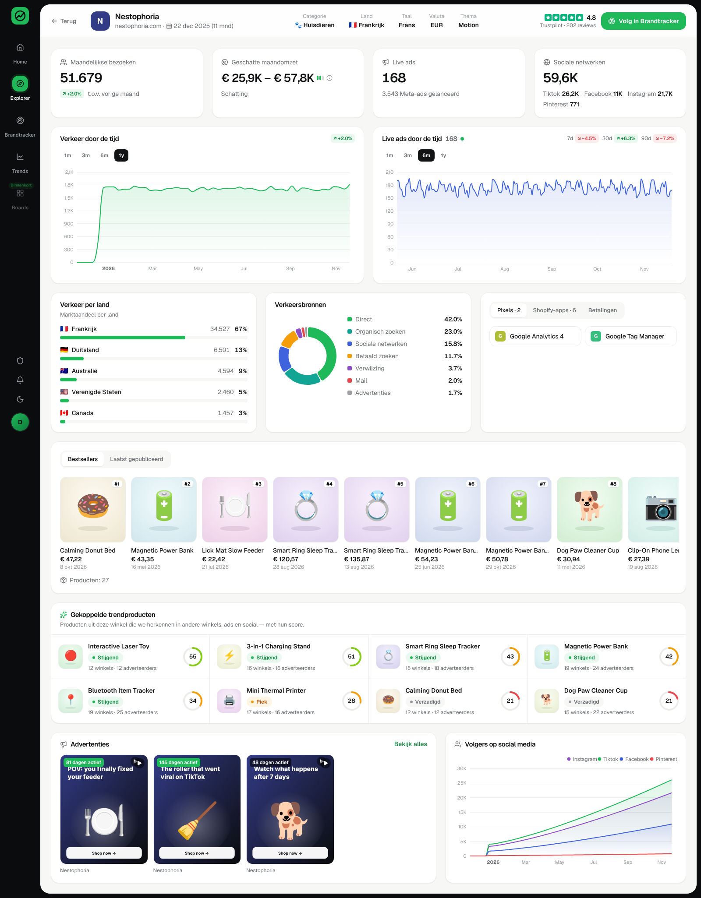
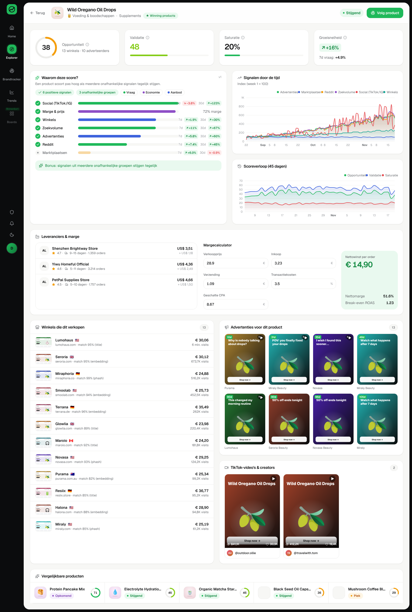

# Trendscope (werknaam)

Trendscope is een all-in-one platform voor e-commerce trend- en concurrentie-intelligentie. Het koppelt producten, winkels, advertenties, creators, zoektrends en leveranciers aan elkaar. Elk product krijgt een **groeisnelheid**, een **validatiescore**, een **saturatiescore** en een **opportuniteitsscore**, en het platform laat altijd zien *waarom* een product zo scoort.

> **Status: fase 1 is klaar.** Architectuur, datamodel, scoring-engine, auth, CI en een complete UI draaien op samenhangende demodata.
> Architectuurplan: [`docs/ARCHITECTURE.md`](docs/ARCHITECTURE.md). Onderzoek naar de UX van TrendTrack: [`docs/research/trendtrack-ux.md`](docs/research/trendtrack-ux.md).

| Shop Explorer | Winkeldetail |
|---|---|
|  |  |
| **Producten met scores** | **Productdetail: "Waarom deze score?"** |
|  |  |
| **Home-dashboard** | **Ads-explorer** |
|  |  |

---

## Lokaal starten

**Vereisten:** Docker, Node 22 met pnpm 10 (`corepack enable`) en [uv](https://docs.astral.sh/uv/).

```bash
make setup          # pnpm install + uv sync + .env aanmaken uit .env.example
make dev-services   # Postgres (pgvector), ClickHouse, Redis, Meilisearch, MinIO, Mailpit
make migrate        # Postgres- en ClickHouse-migraties
make seed           # demowereld: 180 winkels, 72 productclusters, ±2.400 producten, ±1.500 ads, scores
make dev            # http://localhost:3000
```

Log in met elk e-mailadres; in dev-modus is geen wachtwoord nodig. Daarna volgt een korte onboarding: je kiest je rol, je niches en je landen, en het dashboard past zich daaraan aan.

`make help` toont alle commando's. `make check` draait wat CI ook draait: lint, typecheck en tests.

### API-keys en accounts

**Voor fase 1 is geen enkele externe key nodig.** Alle connectors draaien in `DATA_MODE=mock`.

| Variabele | Nodig vanaf | Waarvoor |
|---|---|---|
| `AUTH_SECRET` | nu | Ondertekent de dev-sessiecookie (min. 32 tekens) |
| `NEXT_PUBLIC_CLERK_PUBLISHABLE_KEY`, `CLERK_SECRET_KEY`, `CLERK_WEBHOOK_SECRET` | productie | Clerk-auth (Google, magic link, 2FA, organisaties); zet `AUTH_MODE=clerk` |
| `META_AD_LIBRARY_ACCESS_TOKEN` | fase 3 | Meta Ad Library API (geverifieerd Meta-account nodig) |
| `ANTHROPIC_API_KEY` | fase 9 | AI-assistent en rapporten |
| `STRIPE_SECRET_KEY`, `STRIPE_WEBHOOK_SECRET` | fase 10 | Billing |

---

## Wat er in fase 1 gebouwd is

**Web-app** (`apps/web`, Next.js 15 + Tailwind 4):
- App-shell in de stijl van TrendTrack: een donkere zijbalk en een afgerond inhoudspaneel, in licht én donker thema. De app is volledig tweetalig (NL/EN).
- **Shop Explorer**:
  - opgeslagen weergaven: Weekly Gems, Top Scaling, Marktleiders, Advertentiepiek en Trafficpiek;
  - 16 filters: bezoekerslanden, herkomst, verkeer, niche, aantal producten, aanmaakdatum, trafficgroei, pixels, taal, thema, apps, valuta, actieve ads en ads-groei;
  - sortering, een lijst- en rasterweergave, sparklines, paginering en CSV-export (met planlimiet).
- **Winkeldetail**:
  - KPI's: bezoeken, geschatte omzet met bandbreedte en betrouwbaarheid, live ads en volgers;
  - grafieken voor verkeer en live ads door de tijd;
  - verkeer per land, verkeersbronnen, pixels, apps en betalingen;
  - bestsellers en laatst gepubliceerde producten, ads en volgers;
  - **gekoppelde trendproducten met hun score**: dit is onze differentiator.
- **Producten-explorer** met opportuniteit, validatie (welke signalen positief zijn), saturatie, groei, trendfase en de vraagcurve.
- **Productdetail**:
  - het "Waarom deze score?"-paneel met de bijdrage per signaal, de signaalgroepen, bonussen en straffen;
  - een signaal-index door de tijd en het scoreverloop;
  - leveranciers met een interactieve margecalculator;
  - de winkels die het product verkopen, ads, TikTok-video's en vergelijkbare producten.
- **Ads-explorer**: een creatives-galerij met de filters status, formaat, dagen actief, land en CTA. EU-bereik en spend worden altijd als schatting getoond.
- **Overige schermen**: Adverteerders, Home-dashboard, Brandtracker (winkels en producten volgen), Trends per niche, Admin (databronstatus en scoregewichten), Instellingen en Onboarding.
- **Auth**:
  - een dev-login met een HMAC-ondertekende cookie, plus Clerk voor productie (webhook-sync via Svix);
  - workspaces met de rollen owner, admin en member;
  - planlimieten en audit-logs.

**Workers** (`workers`, Python 3.12):
- `PoliteHttpClient`: respecteert robots.txt, hanteert een rate limit per domein en globaal, gebruikt een identificeerbare User-Agent, doet backoff met `Retry-After` en ondersteunt conditional requests.
- Het connector-framework werkt met een manifest per bron. Productie weigert connectors zonder juridisch akkoord.
- De **Shopify-connector** parseert `/products.json`, met een fixture en wijzigingsdetectie via content-hash.
- De **scoring-engine** berekent groei, percentielen per categorie, onafhankelijke signaalgroepen, een poort bij minder dan 3 signalen, een convergentiebonus, een concentratiestraf, saturatie, opportuniteit en de trendfase, met een volledige uitleg.
- De seed-generator vult Postgres en ClickHouse met een samenhangende demowereld.

**Data:** 4 Postgres-migraties (met werkende down-migraties, RLS en pgvector) en 2 ClickHouse-migraties (snapshots, dagelijkse signalen, scorehistorie en winkelmetrics).

**Kwaliteit:**

| Wat | Resultaat |
|---|---|
| TypeScript-unit-tests | 28 |
| Python-tests | 19 (incl. integratie) |
| Playwright end-to-end-tests | 8 |
| Typecheck | strict TS + mypy strict |
| Lint | ruff |
| CI | `.github/workflows/ci.yml` (incl. migraties op en neer, seed, controle op actuele gegenereerde types, build en e2e) |

**Performance (lokaal, productie-build, demodata):** de meeste schermen laden in 50–215 ms per pagina, ook met filters.

## Bekende beperkingen

- **Alle data is fictief** (label "Demodata"). Echte bronnen volgen per fase en per connector, na juridisch akkoord.
- **Zoeken** gebeurt nog via Postgres (`ILIKE` + trigram-index). Meilisearch staat klaar in Docker Compose en wordt in fase 2 gekoppeld.
- **Clerk** is geïmplementeerd maar zonder echte keys niet getest. Uitloggen in Clerk-modus verloopt nog niet via Clerk.
- De scheduler en Celery-taken zijn nog niet gebouwd (fase 2). De CLI `trendscope crawl` draait één connector handmatig.
- Er zijn nog geen deploy-workflows (Vercel/Hetzner) en geen Terraform. Die komen zodra er een productieomgeving is.
- Afwijkingen van het oorspronkelijke plan staan in [`docs/adr/0001-fase-1-keuzes.md`](docs/adr/0001-fase-1-keuzes.md).

## Volgende stap: fase 2 (Store intelligence)

- Echte Shopify-crawler: scheduler met prioriteiten, Celery-taken, dagelijkse snapshots en diff-detectie (nieuwe en verwijderde producten, prijs- en voorraadwijzigingen).
- Technologiedetectie: thema, apps, pixels en betaalproviders uit de HTML.
- Store discovery via Certificate Transparency-logs en sitemaps.
- Meilisearch-indexering en een freshness-dashboard.

## Structuur

```
apps/web            Next.js-app (UI, server actions, API-routes)
packages/db         Kysely-client + gegenereerde types (bron: SQL-migraties)
packages/core       Domeinlogica: plannen/limieten, rechten, schattingen, unit economics
workers/            Python: connectors, HTTP-client, scoring, seed, CLI
db/postgres         dbmate-migraties
db/clickhouse       ClickHouse-migraties
infra/docker        docker-compose voor lokale ontwikkeling
docs/               architectuur, ADR's, bronnen (juridisch), onderzoek, screenshots
```
