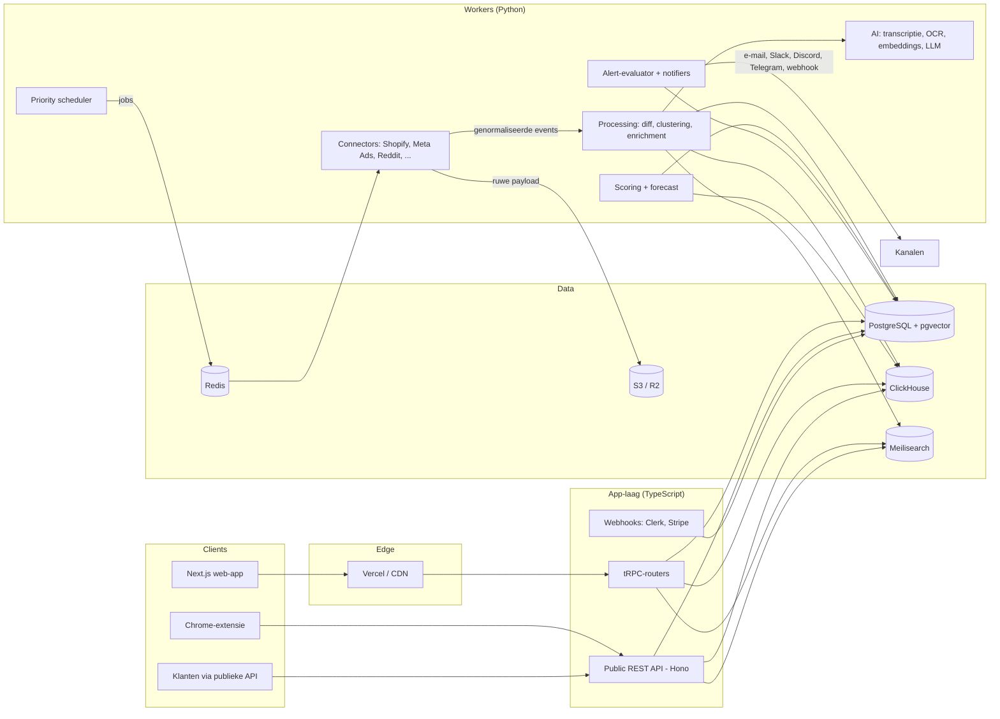

# Architectuurplan — E-commerce Trend & Competitive Intelligence Platform

> Status: **voorstel (fase 1), wacht op akkoord.** Werknaam in dit document: **Trendscope**.
> Nog geen code gebouwd; na akkoord start fase 1 (scaffold, CI/CD, auth, basis-UI).

---

## 1. Samenvatting van de keuzes

| Onderdeel | Keuze | Waarom |
|---|---|---|
| Repo | **Monorepo**: pnpm + Turborepo (TypeScript) en uv-workspace (Python) | Eén PR kan UI, API en worker tegelijk wijzigen; gedeelde types en migraties. |
| Frontend | Next.js 15 (App Router) + TypeScript + Tailwind + shadcn/ui, TanStack Table, ECharts | ECharts schaalt beter dan Recharts voor tijdreeksen met veel punten. |
| Interne API | **tRPC** binnen de Next.js-app | End-to-end types, geen aparte deploy nodig voor de UI. |
| Publieke API | **REST + OpenAPI** (Hono, aparte app `apps/public-api`) | Stabiel contract voor klanten, eigen rate limiting en API-key-scopes; GraphQL later optioneel. |
| Workers | **Python 3.12**: httpx, Playwright (alleen waar nodig), selectolax, pydantic | Beste ecosysteem voor scraping, data en ML. |
| Queue/scheduling | **Redis + Celery** met een eigen *priority scheduler* in Postgres | Eenvoudig te draaien; Temporal pas als workflows (e-mail-seeding, backtests) dat vragen. |
| OLTP | **PostgreSQL 16** (+ pgvector) | Kernentiteiten, gebruikers, billing, alerts. |
| Tijdreeksen | **ClickHouse** | 100M+ snapshots, snelle aggregaties voor scoring en grafieken. |
| Zoeken | **Meilisearch** achter een `SearchIndex`-interface | Snel, eenvoudig; vervangbaar door Typesense/Elastic zonder app-wijzigingen. |
| Vectoren | **pgvector (HNSW)**, migratiepad naar Qdrant boven ~20M vectoren | Eén database minder in het begin. |
| Migraties | **SQL als bron van waarheid** (dbmate) voor Postgres én ClickHouse; TS-types via `kysely-codegen`, Python via pydantic-modellen | Geen dubbele schemadefinitie in twee talen. |
| Auth | **Clerk** (Organizations = workspaces, Google-login, magic link, 2FA) + gespiegelde `users`/`workspaces` in Postgres via webhooks. Lokale **dev-auth-modus** zonder keys | Snelste weg naar teams + rollen; wij blijven eigenaar van de data. |
| Billing | Stripe Billing + Stripe Tax; limieten via `usage_counters` | |
| Opslag | S3-compatibel (Cloudflare R2 aanbevolen: geen egress-kosten) + CDN; lokaal MinIO | Creatives en screenshots zijn egress-zwaar. |
| AI | LLM-provider-abstractie (standaard Claude), Whisper, OCR (PaddleOCR/Tesseract), CLIP/SigLIP-embeddings | |
| Infra | Docker; Vercel (web) + Hetzner (workers, Postgres, ClickHouse, Redis) via Terraform; GitHub Actions | Hetzner is voor crawl- en DB-workloads ~4–6× goedkoper dan AWS. |
| Observability | Sentry, Prometheus + Grafana, OpenTelemetry, freshness-dashboard per connector | |
| i18n | `next-intl` (NL + EN) | |

---

## 2. Systeemoverzicht



### Datastroom (elke bron volgt hetzelfde patroon)

1. **Scheduler** kiest wat er gecrawld wordt op basis van `crawl_targets.next_run_at` en prioriteit (populariteit, groei, watchlist-volgers, freshness-SLA).
2. **Connector** haalt data op (officiële API waar mogelijk), bewaart de **ruwe response** in S3 (`raw/{source}/{date}/{id}.json.zst`) — zo kunnen we parsers later opnieuw draaien en hebben we fixtures voor tests.
3. **Parser** zet ruwe data om naar genormaliseerde pydantic-modellen.
4. **Processor** doet upsert in Postgres, berekent een content-hash en schrijft **alleen bij wijziging** een snapshot naar ClickHouse (essentieel voor 100M+ snapshots), en publiceert change-events (`product.added`, `price.changed`, `ad.started` …).
5. **Enrichment** (async): afbeeldingen → pHash + embedding, video → transcript, beeld → OCR, product → cluster-matching.
6. **Scoring** draait dagelijks (hot items elk uur) op ClickHouse-aggregaten en schrijft naar `scores`.
7. **Alert-evaluator** consumeert change-events en nieuwe scores en matcht ze tegen `alert_rules`.

---

## 3. Mappenstructuur (monorepo)

```
.
├── apps/
│   ├── web/                    # Next.js App Router (app, marketing, docs, admin)
│   │   ├── app/[locale]/(marketing)/…
│   │   ├── app/[locale]/(app)/…        # dashboard, products, stores, ads, trends, …
│   │   ├── app/[locale]/(admin)/…
│   │   ├── server/trpc/                 # routers per module
│   │   └── messages/{nl,en}.json
│   ├── public-api/             # Hono REST + OpenAPI, API-key auth, rate limits
│   └── extension/              # Chrome-extensie (fase 11, Plasmo/WXT)
├── packages/
│   ├── db/                     # Kysely-client, gegenereerde types, queries
│   ├── ui/                     # shadcn/ui-componenten, charts, data-table
│   ├── core/                   # domeinlogica TS: plans/limits, permissies, alert-rule-schema (zod)
│   ├── config/                 # eslint, tsconfig, tailwind-preset
│   └── i18n/
├── workers/                    # Python (uv workspace)
│   ├── trendscope_core/        # settings, db-clients, S3, logging, metrics, rate limiter
│   ├── connectors/             # één map per bron, elk met manifest.yaml + fixtures
│   │   ├── shopify/
│   │   ├── meta_ad_library/
│   │   ├── reddit/
│   │   └── …
│   ├── pipeline/               # parsers → processors → change-events
│   ├── enrichment/             # tech-detectie, pHash, embeddings, OCR, Whisper
│   ├── clustering/
│   ├── scoring/                # signalen, scores, fase-classificatie, forecast, backtest
│   ├── alerts/                 # evaluator + notifiers
│   └── scheduler/
├── db/
│   ├── postgres/migrations/    # dbmate SQL
│   ├── clickhouse/migrations/
│   └── seed/                   # deterministische mock-/seeddata
├── infra/
│   ├── docker/                 # docker-compose.dev.yml, Dockerfiles
│   └── terraform/              # Hetzner, R2, DNS
├── docs/
│   ├── ARCHITECTURE.md
│   ├── sources/                # per databron: juridische basis, rate limits, ToS-notities
│   ├── privacy/                # verwerkingsregister, retentiebeleid
│   └── adr/                    # architectuurbeslissingen
├── .github/workflows/
├── .env.example
└── Makefile                    # make dev, make test, make seed, make migrate
```

---

## 4. Connector-framework (juridisch afdwingbaar)

Elke databron is een losse, uitschakelbare module met een **manifest**:

```yaml
# workers/connectors/shopify/manifest.yaml
id: shopify_storefront
display_name: Shopify publieke storefront-endpoints
kind: scrape_public          # official_api | partner_api | scrape_public | user_provided
legal_basis_doc: docs/sources/shopify.md
legal_review: pending        # pending | approved | rejected  -> alleen 'approved' draait in productie
respects_robots_txt: true
default_rate_limit: { per_domain_rps: 0.5, global_rps: 50 }
requires_credentials: []
personal_data: none          # none | public_business | ...
retention_days: 730
```

Afgedwongen in code (niet alleen in docs):
- Een feature-flag per connector (admin-panel), en productie weigert connectors met `legal_review != approved`.
- Centrale `PoliteHttpClient`: robots.txt-check en cache, per-domein token bucket, identificeerbare User-Agent met contact-URL, exponential backoff, respecteert `Retry-After`. **Geen** CAPTCHA-solvers, login-omzeiling of fingerprint-spoofing. Proxies alleen per connector expliciet toegestaan.
- Elke run schrijft naar `crawl_jobs` (status, duur, fouten, aantal items) → freshness-dashboard en alerts bij uitval.

### Bronnenmatrix (eerste inschatting, jurist toetst)

| Bron | Toegang | Risico | Opmerking |
|---|---|---|---|
| Shopify `/products.json`, sitemaps | publiek endpoint | laag–middel | Breed gebruikt; robots.txt + rate limits respecteren. |
| Certificate Transparency (crt.sh / CT-logs) | open data | laag | Store discovery. |
| Meta Ad Library API | **officieel** | laag | Let op: commerciële ads zijn via de API vooral beschikbaar voor ads die in de **EU** zijn vertoond (DSA); buiten de EU alleen politieke ads. Vereist identiteitsverificatie van het Meta-account. |
| TikTok Commercial Content Library API | officieel, aanvraag | laag | Toegang via aanvraag; dekking vooral EU. Creative Center heeft geen publieke API. |
| Google Ads Transparency Center | geen REST-API | middel | Te verifiëren: publieke BigQuery-dataset; anders alleen beperkte publieke weergave. |
| Google Trends | officiële API (alpha, beperkte toegang) | laag–middel | Aanvragen; tot dan via data-partner. Keyword-volumes via DataForSEO e.d. |
| Reddit | officiële API | laag | Commercieel gebruik vereist betaalde/goedgekeurde toegang. |
| YouTube | Data API v3 | laag | Quota-beperkt. |
| Pinterest | API v5 (o.a. trends-endpoints) | laag | App-review nodig. |
| AliExpress | Affiliate/Open Platform API | laag | Orders/reviews deels beschikbaar. |
| CJ Dropshipping | officiële API | laag | |
| Amazon | PA-API (affiliate-voorwaarden) | middel | Sales-schattingen via eigen BSR-model. |
| TikTok Shop (Kalodata-achtige data) | **geen officiële API voor derden** | **hoog** | Alleen publieke pagina's; jurist moet expliciet akkoord geven. Alternatief: datapartner. |
| Instagram / TikTok creators | beperkte officiële API's | hoog | Business Discovery API (IG) is beperkt; voorzichtig met persoonsgegevens (AVG). |
| Temu, Etsy, Alibaba | Etsy: officiële API; Temu/Alibaba: geen | middel–hoog | Temu-scraping waarschijnlijk niet toegestaan volgens ToS. |
| Seed-mailboxen | eigen inschrijvingen | laag–middel | Eigen domeinen; alleen marketingmail van bedrijven. |

**Belangrijk om vroeg te weten:** de modules die concurrenten het meest onderscheiden (TikTok Shop GMV, creator-data, non-EU Meta-ads) zijn juist de bronnen zonder officiële API. Het plan houdt die achter de connector-vlag en levert ze eerst met mockdata, zodat de rest van het product niet van die beslissing afhangt.

---

## 5. Datamodel — aanvullingen op jullie schema

Het voorgestelde datamodel neem ik over. Aanvullingen en verdeling:

**PostgreSQL** (bron van waarheid voor entiteiten):
- `stores`, `store_technologies`, `products`, `product_clusters`, `cluster_members`, `suppliers`, `supplier_offers`, `ads`, `advertisers`, `creators`, `videos`, `livestreams`, `tiktok_shops`, `keywords`, `emails`, `scores` (alleen laatste dag; historie in ClickHouse), en alle tenant-tabellen.
- Extra: `crawl_targets` (url/entity, priority, interval, next_run_at, etag, content_hash), `connectors` (flags, laatst geslaagd), `entity_links` (generieke koppeltabel product↔store↔ad↔creator↔keyword met `link_type`, `confidence`, `evidence_json`) — dit is de kern-differentiator en verdient een eigen tabel in plaats van losse FK's.
- `score_weights` (versie-beheerd; elke score bewaart `weights_version` voor reproduceerbare backtests).
- `feature_flags`, `curated_lists`, `deletion_requests`.
- ID's: `bigint identity` voor data-entiteiten (compact in ClickHouse), `uuid v7` voor tenant-entiteiten.
- Multi-tenancy: elke tenant-tabel heeft `workspace_id`; afgedwongen in een centrale query-laag + Postgres Row Level Security als vangnet.

**ClickHouse** (append-only, partitie per maand):
- `product_snapshots`, `ad_snapshots`, `creator_snapshots`, `video_snapshots`, `keyword_signals`, `reddit_mentions`, `score_history`, `change_events`.
- Engine `ReplacingMergeTree`, `PARTITION BY toYYYYMM(captured_at)`, `ORDER BY (entity_id, captured_at)`, TTL per retentiebeleid.
- Materialized views voor dagelijkse rollups (`*_daily`) waar de scoring en de grafieken op draaien.

**Meilisearch**: indexen `products`, `stores`, `ads`, `creators`, `keywords`; gevoed via change-events, met scores als sorteer- en filterattributen.

---

## 6. Scoring-engine (ontwerp)

**Signalen** per entiteit per dag, voor vensters 1/7/30 dagen:
- Groei als `g = log((x_t + k) / (x_{t-w} + k))` (stabiel bij kleine aantallen, `k` per signaal).
- Normalisatie naar 0–1 via **percentiel binnen categorie** (anders domineren grote categorieën), met winsorizing.
- Elk signaal krijgt ook een **betrouwbaarheid** (dekking en versheid van de bron); ontbrekende bronnen tellen niet als negatief.

**Onafhankelijkheid**: signalen worden gegroepeerd zodat gecorreleerde bronnen niet dubbel tellen:
- *Aanbod*: S_store, S_ads
- *Vraag*: S_search, S_reddit, S_social
- *Transacties*: S_tiktokshop, S_marketplace
- *Economie*: S_price

**Scores**:
- `growth_velocity = Σ w_i · g_i` (gewichten uit `score_weights`).
- `validation (0–100)`: basis = gewogen gemiddelde van positieve signalen; **poort**: < 3 positieve signalen → max 40; **convergentiebonus** als ≥ 2 groepen positief zijn; **concentratiestraf** als één signaal > 60% van de bijdrage levert.
- `saturation (0–1)` = sigmoïde van `log(stores + advertisers)` gedeeld door vraaggroei (vraag stijgt harder dan aanbod → lage saturatie).
- `opportunity = validation × (1 − saturation) × margin_factor`.
- **Trendfase** (opkomend/stijgend/piek/verzadigd/dalend): regelgebaseerd op eerste/tweede afgeleide van het vraagsignaal + saturatie; later vervangen door een classifier zodra er gelabelde historie is.
- **Forecast 30/90 d**: LightGBM op lag-features (snel, schaalbaar, werkt over miljoenen reeksen); Prophet alleen voor keyword-seizoenspatronen.
- **Uitleg**: `breakdown_json` bevat per signaal waarde, groei, gewicht, bijdrage en een korte tekstuele reden ("3 nieuwe winkels deze week, ad-varianten ×2, zoekvolume +45%").
- **Backtesting**: `scoring/backtest.py` speelt historische snapshots af met een gegeven `weights_version` en meet precision@k / lead time (hoeveel dagen vóór de piek scoorde het item in de top-k).

---

## 7. App-laag, security en limieten

- **Rollen**: owner, admin, member (+ platform-admin). Permissies centraal in `packages/core/permissions.ts`.
- **Plannen en limieten** als configuratie (`plans.ts` + DB-override), gecontroleerd in één `assertWithinLimit(workspace, feature)`-functie; tellers in `usage_counters` met Redis als snelle teller.
- **Data-venster per plan** (Free = 7 dagen) wordt in de query-laag afgedwongen, niet in de UI.
- **Publieke API**: API-keys gehasht opgeslagen (prefix zichtbaar), scopes per key, sliding-window rate limits in Redis, OpenAPI-docs gegenereerd.
- **Audit-logs** voor teamwijzigingen, API-key-acties, exports en admin-acties.
- **Secrets**: Doppler of 1Password/SOPS; nooit in de repo.
- **Schatting-labels**: elk geschat veld wordt via het API-contract geleverd als `{ value, low, high, confidence, method }`; de UI-component `<Estimate>` toont dit altijd met label.

---

## 8. CI/CD en omgevingen

- **GitHub Actions**:
  - `ci.yml`: pnpm lint/typecheck/test (Vitest), ruff + mypy + pytest, SQL-migraties tegen Postgres- en ClickHouse-servicecontainers, Playwright E2E tegen de seed-dataset.
  - `deploy-web.yml`: Vercel preview per PR, productie bij merge op `main`.
  - `deploy-workers.yml`: Docker-images naar GHCR, deploy naar Hetzner.
  - Turborepo-cache en path-filters, zodat alleen gewijzigde delen draaien.
- **Omgevingen**: local (docker-compose: Postgres, ClickHouse, Redis, Meilisearch, MinIO, Mailpit), preview, staging, productie.
- **Mock-modus**: `DATA_MODE=mock` laat elke connector fixtures lezen in plaats van externe API's, en `make seed` vult alle databases met een samenhangende fictieve dataset (winkels ↔ producten ↔ ads ↔ creators ↔ keywords), zodat elk scherm werkt zonder API-keys.

---

## 9. Schaal en performance

- **1M+ winkels**: getrapte crawl-frequentie (hot: dagelijks, normaal: wekelijks, slapend: maandelijks); conditional requests (ETag/Last-Modified) en content-hashing. Schatting: ~1–3M requests per dag ≈ 15–35 req/s verdeeld over veel domeinen, haalbaar met enkele workers.
- **100M+ snapshots**: alleen schrijven bij wijziging, ClickHouse-compressie, rollups per dag.
- **< 500 ms zoeken**: lijsten komen uit Meilisearch (met scores als attributen), detailpagina's uit Postgres + voorgeaggregeerde ClickHouse-rollups; Redis-cache voor dashboard-widgets.
- **Grote tabellen**: server-side paginatie (keyset), virtualisatie in de UI.

---

## 10. Fase 1 — wat ik na akkoord bouw

1. Monorepo-scaffold (pnpm/Turborepo + uv), lint/format/typecheck-configuratie.
2. `docker-compose.dev.yml` met alle datastores + Mailpit + MinIO; `Makefile`; `.env.example`.
3. Eerste migraties: tenants (users, workspaces, memberships, api_keys, audit_logs, feature_flags) en het kernschema (stores, products, ads, …), plus ClickHouse-snapshottabellen.
4. Auth: Clerk-integratie met Organizations ↔ workspaces, webhook-sync, rollen; **dev-auth** zonder keys.
5. Basis-UI: app-shell (sidebar, command-palette, NL/EN, dark mode), dashboard met mockdata, productlijst met TanStack Table (server-side filter/paginatie), productdetail met score-uitleg en ECharts, placeholderpagina's voor alle modules.
6. Python-workerskelet: settings, `PoliteHttpClient`, connector-basisklasse + manifest-validatie, Celery-app, één voorbeeldconnector in mock-modus.
7. Seed-script met samenhangende demo-data.
8. CI-workflows (lint, typecheck, unit-tests, migratietest, één Playwright-smoketest).
9. `docs/sources/_template.md` en ADR's voor de keuzes hierboven.

**Definition of done fase 1:** `make dev` start alles lokaal, inloggen werkt (dev-auth of Clerk), dashboard en productlijst tonen seeddata, CI is groen.

---

## 11. Beslispunten voor akkoord

1. **Auth**: Clerk (aanbevolen, snelst voor teams en 2FA) of Supabase Auth (goedkoper bij veel gebruikers, meer zelf bouwen)?
2. **Backend-taal voor de app-API**: TypeScript (tRPC + Hono, aanbevolen) met Python alleen voor workers, of FastAPI voor alles server-side?
3. **Hosting**: Vercel + Hetzner (aanbevolen, kostenefficiënt) of volledig AWS?
4. **Productnaam / werknaam** voor de repo en UI (nu "Trendscope").
5. **Prioriteit hoog-risicobronnen** (TikTok Shop, creators, non-EU ads): eerst met mockdata en een datapartner evalueren, of direct scraping onderzoeken na juridisch advies?
6. **Primaire markt** voor de eerste versie (NL/EU of wereldwijd)? Dat bepaalt de Meta-Ad-Library-dekking en het taalbeleid voor keywords.
